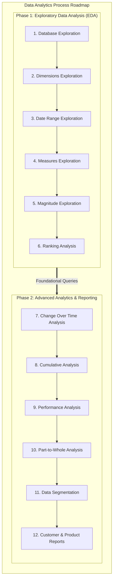

# Retail Sales Data Warehouse and Analytics

An end-to-end data warehousing and analytics solution using Apache Spark (Databricks), Delta Lake, and Power BI, implementing a Medallion Architecture (Bronze, Silver, Gold) to ingest, clean, model, and analyze retail sales data from CRM and ERP sources.

## Data Architecture

The warehouse follows the Medallion Architecture pattern to process raw extracts into analytical models:

```mermaid
flowchart LR
    subgraph Sources["Sources"]
        direction TB
        CRM["CRM System<br/>(CSV Files)"]
        ERP["ERP System<br/>(CSV Files)"]
    end

    subgraph DWH["Databricks Delta Lake Data Warehouse"]
        direction LR

        subgraph Bronze["Bronze Layer<br/>(Raw Delta Tables)"]
            direction TB
            B_Type["Delta Tables"]
            B_Load["PySpark Ingestion with Schema Enforcement"]
            B_Trans["Raw (As-Is)"]
        end

        subgraph Silver["Silver Layer<br/>(Cleaned & Standardized)"]
            direction TB
            S_Type["Delta Tables"]
            S_Load["PySpark ELT Pipeline"]
            S_Trans["Deduplication, Normalization & Cleaning"]
        end

        subgraph Gold["Gold Layer<br/>(Business-Ready)"]
            direction TB
            G_Type["Delta Tables / Views"]
            G_Load["Dimensional Modeling"]
            G_Trans["Star Schema (Facts & Dims)"]
        end

        Bronze -->|Cleanse & Standardize| Silver
        Silver -->|Model & Aggregate| Gold
    end

    subgraph Consume["Consume Layer"]
        direction TB
        BI["Power BI Dashboards"]
        AdHoc["Spark SQL Analytics"]
    end

    CRM --> Bronze
    ERP --> Bronze

    Gold --> BI
    Gold --> AdHoc
```

1. **Bronze Layer**: Ingests raw CSV extracts from CRM and ERP systems as-is into Delta tables with explicit schema enforcement.
2. **Silver Layer**: Cleanses, standardizes, resolves data quality issues, deduplicates via window functions, and normalizes data for modeling.
3. **Gold Layer**: Exposes business-ready star-schema dimension (`dim_customers`, `dim_products`) and fact (`fact_sales`) Delta tables for reporting.

## Tech Stack

- **Platform:** Databricks (Apache Spark, Delta Lake)
- **Languages:** Python (PySpark), Spark SQL
- **Data Modeling:** Star Schema (Facts & Dimensions)
- **ETL / Orchestration:** PySpark Jupyter Notebooks
- **Analytics & BI:** Spark SQL, Power BI

## Project Requirements

### Data Engineering
- **Sources:** Ingest ERP and CRM CSV datasets into Bronze Delta tables.
- **Data Quality:** Identify and resolve missing values, duplicate records, and invalid formats.
- **Data Model:** Consolidate data into dimension (`dim_customers`, `dim_products`) and fact (`fact_sales`) tables.
- **Scope:** Latest snapshot data processing.

### Analytics & Reporting
Deliver Spark SQL and PySpark insights into:
- **Customer Behavior:** Demographics, recency, order frequency, segmentation.
- **Product Performance:** Sales volume, category margins, top/bottom performers.
- **Sales Trends:** Growth over time, cumulative revenue, seasonality.

## Analytics Roadmap

