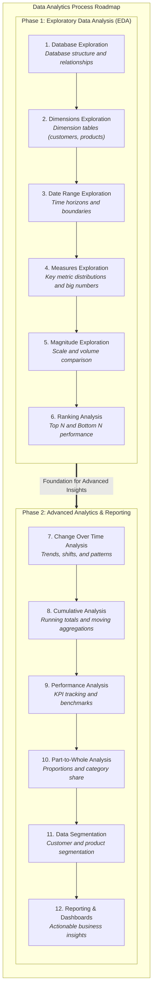

# Report - Data Analysis and Business Insights

This section summarizes the data analysis process and the resulting reports, providing valuable business insights.

## Data Exploration and Analysis
The EDA process was conducted using SQL queries. 
The analysis followed a structured approach, covering various aspects of the data:

1. **Database Exploration:** Understanding the structure and relationships within the database.
2. **Dimensions Exploration:** Analyzing the characteristics of the dimension tables (customers, products).
3. **Date Range Exploration:** Identifying the time period covered by the data.
4. **Measures Exploration:** Examining key metrics and their distributions.
5. **Magnitude Exploration:** Understanding the scale of different measures.
6. **Ranking Analysis:** Identifying top performers (e.g., customers, products).
7. **Change Over Time Analysis:** Tracking trends and patterns over time.
8. **Cumulative Analysis:** Examining the accumulated values of metrics.
9. **Performance Analysis:** Evaluating the performance of different aspects of the business.
10. **Data Segmentation:** Grouping data into meaningful segments for targeted analysis.
11. **Part-to-Whole Analysis:** Understanding the contribution of different parts to the overall picture.

## Final Reports

Two key reports were generated to provide business insights:

### 1. Customer Report (`12_report_customers.ipynb`)

This report consolidates key customer metrics and behaviors, including:

* Demographics (name, age, location)
* Transaction history (orders, sales, quantity)
* Customer segmentation (VIP, Regular, New)
* Key performance indicators (KPIs):
    * Recency (months since last order)
    * Average order value (AOV)
    * Average monthly spend

This report helps understand customer behavior, identify valuable customer segments, and personalize marketing efforts.

### 2. Product Report (`13_report_products.ipynb`)

This report summarizes key product metrics and performance, including:

* Product details (name, category, cost)
* Sales performance (orders, sales, quantity)
* Product segmentation (High-Performers, Mid-Range, Low-Performers)
* Key performance indicators (KPIs):
    * Recency (months since last sale)
    * Average order revenue (AOR)
    * Average monthly revenue

This report helps analyze product performance, identify top-selling products, and make informed decisions about product development and marketing.
